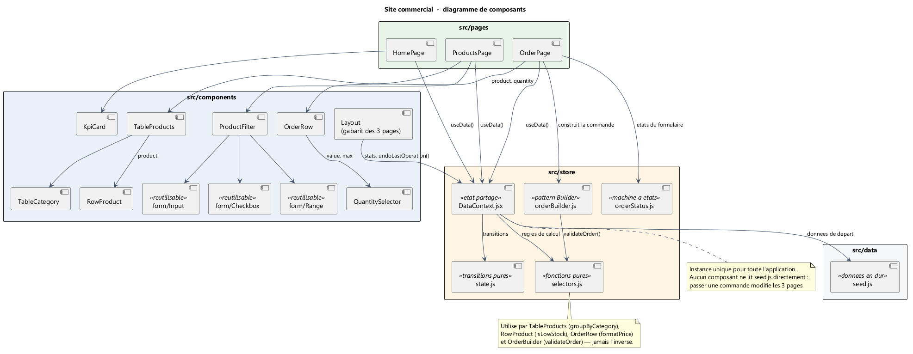
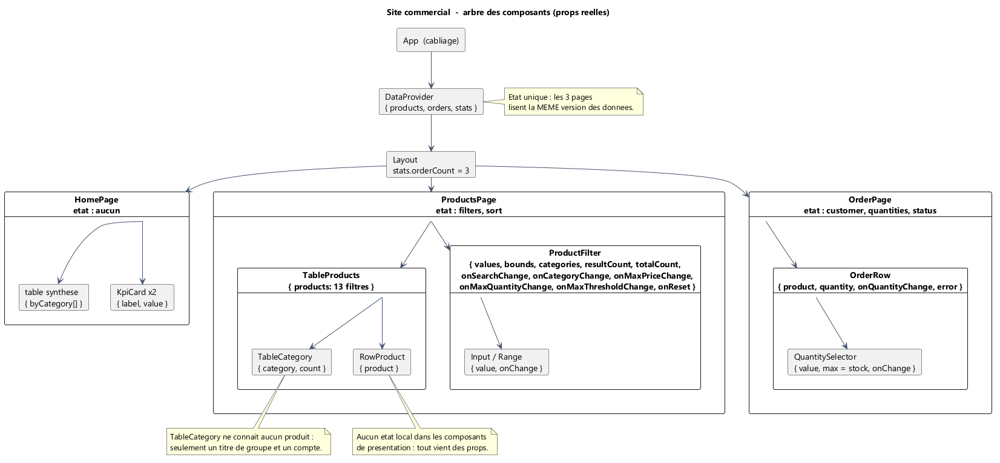
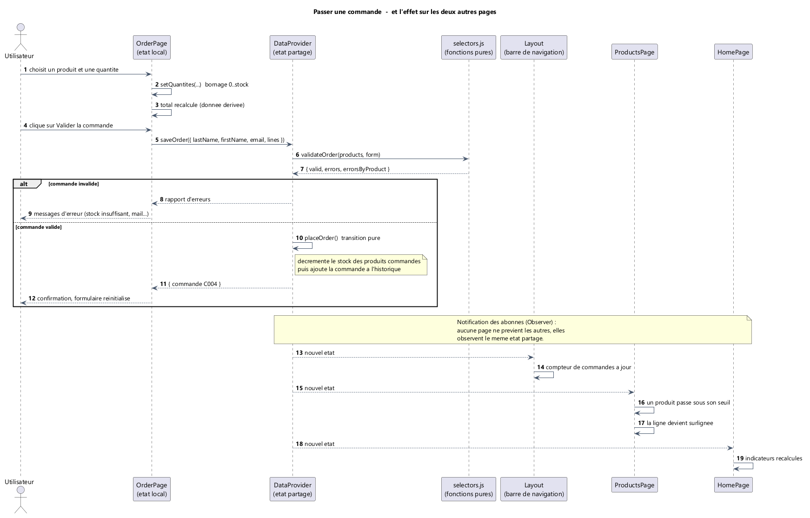

# Analyse des design patterns — Mini projet « Site commercial »

| | |
|---|---|
| Binôme | SONG Wenkai (A) · SUI Wenhui (B) |
| Application | Site commercial React — 3 pages virtuelles, sans partie serveur |
| Dépôt | https://github.com/wenkais196-Gabriel/mini-projet-site-commercial |
| Composants | `docs/diagrammes/` |

---

## 1. Architecture de l'application

Une seule page HTML réelle ; trois **pages virtuelles** gérées par `react-router`.
Aucun appel réseau : les données initiales sont en dur dans `src/data/seed.js`.

Le sujet impose que « les données soient liées entre les pages virtuelles ». Une
donnée ne peut donc appartenir à une page : elle appartient à un **ancêtre commun**,
le `DataProvider`, monté au-dessus du router.

```
App  (câblage : DataProvider + BrowserRouter)
└── DataProvider              ← état partagé : { products, orders }
    └── Layout                ← barre de navigation + <Outlet/>
        ├── HomePage          ← lit uniquement des indicateurs dérivés
        ├── ProductsPage      ← orchestre ProductFilter + TableProducts
        └── OrderPage         ← orchestre le formulaire et demande une commande
```

Deux séparations structurent tout le code :

- **composants de présentation** (ne connaissent que leurs `props`, aucun état) vs
  **composants orchestrateurs** (les 3 pages : ce sont les seules à avoir un état) ;
- **règles métier** dans des modules **purs** — `selectors.js` (calculs et
  validation), `state.js` (transitions), `orderBuilder.js` (construction d'une
  commande), `orderStatus.js` (machine à états du formulaire) — séparées de la
  **colle React** (`DataContext.jsx`) et de **l'affichage** (les composants).

---

## 2. Partie 1 — Modélisation et implémentation

### 2.1 Composants standards et composants non standards

| Composant | Catégorie | Ce qui le rend standard / non standard |
|---|---|---|
| `Input`, `Range`, `Checkbox` | **Standard** | Les atomes du cours (exercice 4) : ils ignorent le métier — « j'affiche une valeur, et je préviens quand elle change ». `Input` et `Range` composent le filtre produits. `Checkbox` appartient à la même famille mais **n'est pas utilisé** : la seule case du cours servait à filtrer les alertes, un critère que le sujet ne demande pas (voir § 4.3). |
| `RowProduct` / `OrderRow` | **Standard** | Présentation pure, pilotés entièrement par leurs `props`. |
| `QuantitySelector` | **Standard** | Ignore le métier : affiche « une quantité bornée dans [0, max] ». Réutilisable hors du projet. |
| `ProductFilter` | **Non standard** | Orchestrateur : compose les atomes de formulaire, agrège 5 critères (tous les attributs), totalement contrôlé, et **un port de sortie par filtre** — exactement la structure du modèle de composants du cours. |
| `TableProducts` | **Non standard** | Composite : regroupe par catégorie et **fabrique** ses lignes (donnée dérivée calculée au rendu). |
| `TableCategory` | **Non standard** | Composant « structurel » : il ne connaît qu'un titre de groupe et un nombre d'éléments, jamais un produit. |
| `KpiCard` | **Non standard** | À facette : `props.children` — la carte fournit le cadre, l'appelant fournit le contenu. |
| `DataProvider` | **Non standard** | Composant **sans rendu visible** (non visuel) : il n'affiche rien, il fournit un état. |
| `Layout` | **Non standard** | Gabarit de route parente : il ne sait pas quelle page il encadre (`<Outlet/>`). |

> Le point à retenir : les composants « non standards » sont ceux qui **décident**
> (ils orchestrent, regroupent, composent ou cachent un état), alors que les
> composants standard se contentent de **montrer** ce qu'on leur donne.

### 2.2 Correspondance avec la terminologie du cours (CCM → React)

| Terme du cours (CCM) | Réalisation dans ce projet |
|---|---|
| composant | fonction retournant du JSX (`RowProduct`, `KpiCard`…) |
| attributs / propriétés | paramètres reçus par déstructuration (`{ product }`, `{ quantity, max }`) |
| source d'événement | `onChange`, `onClick` → **flux inverse** via les props de rappel (`onQuantityChange`) |
| sink | composants de présentation qui produisent le DOM (`RowProduct`) |
| facette | `props.children` de `KpiCard` |
| réceptacle | `QuantitySelector.max`, et `DataProvider` qui reçoit `today` en prop |
| configuration | le JSX de `App.jsx` : c'est le câblage de l'application |
| état local | `useState` dans les 3 pages uniquement (`filters`, `customer`, `quantities`) |

### 2.3 Diagrammes

| Fichier | Contenu |
|---|---|
| `docs/diagrammes/01-diagramme-composants.puml` `.png` | Diagramme de composants : dépendances, ports, points d'assemblage |
| `docs/diagrammes/02-arbre-composants.puml` `.png` | Arbre des composants avec les valeurs réelles des `props` |
| `docs/diagrammes/03-sequence-commande.puml` `.png` | Séquence : passer une commande, et l'effet sur les deux autres pages |

**Figure 1 — Diagramme de composants de l'application**



**Figure 2 — Arbre des composants, avec les valeurs réelles des `props`**



**Figure 3 — Séquence : passer une commande et l'effet sur les deux autres pages**



---

## 3. Partie 2 — Analyse des design patterns

### 3.1 Vue d'ensemble

| Pattern | Verdict | Où c'est / où ce serait | Effort |
|---|---|---|---|
| **MVC** | Présence partielle — version classique **incompatible** | Modèle = `store` + `selectors` ; Vue = composants ; Contrôleur = pages et gestionnaires d'événements | — |
| **Singleton** | **Présent** (sous une forme adaptée à React) | `DataProvider` + `useData()` : un seul état partagé, un seul point d'accès | — |
| **Abstract Factory** | **Incompatible en l'état** (compatible si on introduit des familles) | Fabrique de lignes/labels par famille de produits | élevé |
| **Builder** | **Présent** | `src/store/orderBuilder.js` — `OrderBuilder` | fait |
| **Decorator** | Compatible, non implémenté — immédiat | HOC `withHighlight(RowProduct)` ou fonction de formatage | faible |
| **Command** | **Présent** | `src/store/state.js` — objets-opérations + `undoOperation` | fait |
| **Observer** | **Présent** (assuré par React) | Abonnement des composants à l'état partagé | — |
| **State** | **Présent** | `src/store/orderStatus.js` — `TRANSITIONS` + `transition` | fait |

### 3.2 MVC

**Verdict — présence partielle ; l'implémentation « classique » est incompatible.**

*Présence.* L'application est bien séparée en trois responsabilités :

| MVC | Ici |
|---|---|
| Modèle | `src/store/DataContext.jsx` (état) + `src/store/selectors.js` (règles pures) |
| Vue | tous les composants de `src/components/` |
| Contrôleur | les pages (`ProductsPage`, `OrderPage`) et leurs gestionnaires d'événements |

*Pourquoi la version classique est incompatible.* Dans un MVC historique (Java,
Swing, Struts), la Vue observe le Modèle et peut lui écrire : c'est un **flux en
deux sens**. React impose l'inverse : un flux descendant par les `props` et un flux
montant par les callbacks (remontée d'événements). Il n'y a jamais de « vue » qui
modifie directement le modèle. De plus, le Contrôleur MVC est un objet distinct
du Modèle ; ici, la logique de contrôle est répartie dans les fonctions de rendu
(hooks), ce qui n'a pas d'équivalent MVC strict.

*Ce qu'on pourrait rapprocher.* Remplacer les `useState` des pages par des
gestionnaires nommés (`FiltresControleur`) rendrait la ressemblance plus explicite,
mais ce serait un habillage : React n'est pas un framework MVC, et le forcer coûte
plus qu'il ne rapporte.

### 3.3 Singleton

**Verdict — présent, et complet au sens du sujet : l'accès unique est garanti, et
aucun composant ne peut créer une seconde copie des données.**

`App.jsx` monte **un seul** `<DataProvider>` : il n'existe qu'une seule instance de
l'état `{ products, orders }` pour toute l'application. `useData()` est le
**point d'accès unique** : aucun composant ne peut créer une seconde copie des
données. C'est la propriété essentielle du Singleton — accès contrôlé à une
ressource unique — et c'est précisément ce qui rend les 3 pages cohérentes.

*La nuance, à dire en soutenance.* Le Singleton « objet global mutable » est un
anti-pattern en React (état partagé invisible, difficile à tester, incompatible avec
le rendu déclaratif). La forme retenue est **état unique + notification** :
l'instance est unique, mais elle est fournie par le haut de l'arbre plutôt que
ramassée dans un coin du code. Le jour où l'on voudrait deux instances (deux
paniers indépendants dans un test), il suffirait de monter deux `DataProvider` —
ce qui est impossible avec un vrai Singleton, et c'est un avantage.

*Reste du code concerné.* Aucune autre ressource globale : le CDN Bootstrap est un
`<link>` dans `index.html`, il n'y a pas d'objet de configuration partagé.

### 3.4 Abstract Factory

**Verdict — incompatible en l'état ; compatible si l'on introduit des familles.**

*Pourquoi incompatible aujourd'hui.* Une fabrique abstraite sert à créer **des
familles d'objets cohérentes entre elles**, choisies à l'exécution. Ici, il n'y a
qu'**une seule famille** : des produits à 5 attributs (`nom`, `categorie`, `prix`,
`quantity`, `threshold`) et une seule façon de les afficher (`RowProduct`). Créer une
fabrique pour une famille unique ajouterait une couche d'indirection sans aucun
choix à faire derrière : du code décoratif.

*Comment on l'ajouterait.* Il faudrait de vraies familles. Par exemple :

1. modéliser des sous-types (`ProduitFrais` avec DLC, `ProduitSec` avec poids,
   `ProduitBoisson` avec contenance) ;
2. définir `FabriqueProduit` avec `creerLigne()` et `creerEtiquette()` ;
3. `FabriqueFrais`, `FabriqueSec`, `FabriqueBoisson` en implémentations ;
4. à l'affichage, `TableProduits` demanderait la fabrique de la ligne et
   obtiendrait des composants cohérents sans jamais connaître le type réel.

*Coût.* Élevé pour le gain : cela suppose de faire évoluer tout le modèle de
données (donc les 3 pages et le store), à la veille de la remise.

### 3.5 Builder

**Verdict — présent, et complet : le Builder assemble la totalité de la commande,
et les deux niveaux de contrôle (immédiat + final) sont tous les deux en place.**
Implémenté dans `src/store/orderBuilder.js` et utilisé par
`OrderPage`.

*Ce que le Builder apporte ici.* Le sujet impose un formulaire qui doit « respecter
les contraintes de quantité disponible ». Ces contraintes sont désormais écrites à un
seul endroit, et la page ne manipule plus un objet en cours d'assemblage :

```js
const commande = new OrderBuilder(produits)
  .setCustomer({ lastName, firstName, email })
  .addLine("P10", 12)          // refusée et signalée si le stock est insuffisant
  .addLine("P01", 3)
  .build();                    // → { valid, form, lines, errors, errorsByProduct }
```

Deux niveaux de contrôle, volontairement :

- `addLine` refuse **tout de suite** une ligne impossible (produit inconnu,
  quantité non entière ou ≤ 0, stock insuffisant — en tenant compte des lignes déjà
  ajoutées) ; la ligne fautive n'entre jamais dans la commande ;
- `build()` délègue le jugement final au validateur : **le Builder assemble, le
  validateur juge**. Une seule définition des règles, jamais deux.

`build()` ne déclare `valid` que sous deux conditions : les règles générales passent
**et** aucune ligne n'a été refusée en chemin — sinon on produirait une commande
silencieusement différente de celle demandée.

*Coût réel.* Une classe d'une centaine de lignes, la réécriture du `onSubmit` de
`OrderPage`, et 14 tests dans `test/orderBuilder.test.js` (refus, cumul des lignes,
copies défensives, contrôle final).

### 3.6 Decorator

**Verdict — compatible, non implémenté, et immédiat à ajouter.**

React encourage la composition plutôt que l'héritage : envelopper un composant
pour lui ajouter un comportement **est** le motif Decorator. Deux emplacements
prêts à l'emploi :

1. **Sur les lignes.** `RowProduct` décide déjà de son surlignage. On pourrait
   extraire cette décision dans un décorateur, et composer plusieurs
   préoccupations indépendantes :

   ```js
   export function withHighlight(Component) {
     return function HighlightedRow(props) {
       const alert = isLowStock(props.product);
       return (
         <div className={alert ? "alert-row" : undefined}>
           <Component {...props} />
         </div>
       );
     };
   }
   const OutOfStockRow = withOutOfStock(withHighlight(RowProduct));
   ```

2. **Sur le prix.** `formatPrice` est aujourd'hui une fonction. Un
   `PriceDecorator` permettrait d'empiler des règles de présentation (prix barré si
   promotion, couleur si prix élevé, affichage HT/TTC) sans toucher aux composants.

*Coût.* Faible — le vrai intérêt pédagogique est de montrer qu'on peut ajouter un
comportement **sans modifier** la classe/composant d'origine (principe ouvert/fermé).
En contrepartie, il faut savoir s'arrêter : empiler des HOC rend l'arbre de
composants difficile à suivre (le « wrapper hell »), et un simple `className`
conditionnel est parfois plus lisible. C'est la raison pour laquelle nous avons
choisi de **ne pas** décorer `RowProduct` dans la version actuelle.

### 3.7 Command

**Verdict — présent, et complet au sens du sujet.** Implémenté dans
`src/store/state.js`, exposé par le store et déclenché par le bouton « Annuler » de
la barre de navigation.

*Où c'est déjà présent.* Le store reçoit des objets de la forme :

```js
dispatch({ type: "PLACE_ORDER", form, date })
```

Chaque action est un objet autonome qui transporte à la fois l'intention (`type`) et
ses paramètres (`form`, `date`) ; le `reducer` est l'exécutant qui traduit
cet objet en modification d'état. C'est exactement la structure du pattern Command :
**une demande encapsulée dans un objet**, que le destinataire exécute sans avoir à
connaître l'appelant. `dispatch` joue le rôle d'invocateur.

*Ce qui a été ajouté pour en faire un Command complet.*

1. une pile `historique[]` dans l'état, qui ne contient que les opérations
   **annulables** (les 3 commandes livrées avec l'application en sont exclues :
   elles font partie des données de départ) ;
2. un interpréteur inverse unique, `undoOperation`, qui réincrémente le stock
   prélevé et retire la commande — un seul endroit à maintenir, quel que soit le
   nombre de types d'opérations ajoutés ensuite ;
3. une action `UNDO_LAST_OPERATION` et le bouton « Annuler » dans la barre de
   navigation, qui affiche la dernière opération annulable (« dernière opération :
   commande C004 »).

*Ce que cela donne en démonstration.* On commande, on annule, et l'on voit le stock
revenir **et** le surlignage disparaître sur la page Produits — l'inverse exact de la
chaîne de données décrite au § 3.8. L'historique est volontairement limité à la
dernière opération : un vrai undo/redo multi-niveaux serait disproportionné pour un
formulaire et difficile à défendre en soutenance.

### 3.8 Observer

**Verdict — présent, adapté à React, et complet : tous les composants de la page
Accueil et de la page Produits sont effectivement re-rendus à partir de la même
source, sans une seule ligne de synchronisation manuelle.**

React applique exactement le pattern Observer : un composant « s'abonne » à une
donnée, et il est automatiquement notifié (re-rendu) quand cette donnée change. Le
`DataProvider` est le **sujet** ; tous les composants qui appellent `useData()` sont
les **observateurs**. Le cas est particulièrement net sur notre application :

```
OrderPage → saveOrder() → l'état { products, orders } change
        ├── Layout         re-rendu  → le libellé de la dernière opération change
        ├── HomePage       re-rendu  → les indicateurs changent
        └── ProductsPage   re-rendu  → le surlignage des produits change
```

Aucune de ces trois pages n'est prévenue par `OrderPage` : elles observent la
même source. C'est aussi ce qui rend possible l'exigence du sujet (« les données
sont liées entre les pages virtuelles ») sans écrire une seule ligne de
synchronisation manuelle.

*Pour rendre le motif encore plus explicite (option).* On pourrait abandonner le
contexte au profit d'un petit store écrit à la main avec `subscribe(observateur)` /
`notify()`, branché sur `useSyncExternalStore`. Ce serait une démonstration
« à la main » du même mécanisme, mais en réécrivant un équivalent de ce que React
fournit déjà — donc un gain pédagogique contre une perte de simplicité.

### 3.9 State

**Verdict — présent, et complet.** Implémenté dans `src/store/orderStatus.js` et
piloté par la page Commande.

*Où l'on en était, et ce qui reste vrai.* L'état de **santé d'un produit** est
toujours *calculé* à la volée — mais il n'a plus besoin d'être affiché sous forme de
libellé, puisque le sujet ne demande qu'un **surlignage** :

```js
export function isLowStock(product)   { return product.quantity < product.threshold; }
export function isOutOfStock(product) { return product.quantity === 0; }
```

La ligne d'un produit est donc surlignée ou non, par déduction, à chaque rendu. C'est
un bon choix pour cette information : rien ne peut se désynchroniser (il ne peut pas
exister un produit marqué « en alerte » qui aurait du stock). Une donnée dérivée ne
mérite pas une machine à états.

*Le cas d'usage que nous avons implémenté : le cycle de vie du formulaire de commande.*

Un formulaire de commande a de vrais états et de vraies transitions :

| État | Peut aller vers | Déclencheur |
|---|---|---|
| `Brouillon` | `En cours de saisie` | premier produit sélectionné |
| `En cours de saisie` | `Valide` / `Invalide` | à chaque modification (règles du modèle) |
| `Invalide` | `En cours de saisie` | correction d'une erreur |
| `Valide` | `Enregistrée` | clic sur « Valider » |
| `Enregistrée` | `Brouillon` | nouvelle commande / annulation (cf. Command) |

Ces états existent maintenant **explicitement**, dans `STATUSES` et dans la table
`TRANSITIONS` — la définition unique de ce qui est permis :

```js
export const TRANSITIONS = {
  [DRAFT]:   { [EDIT]: EDITING, [VERIFICATION_FAILED]: INVALID },
  [EDITING]: { [EDIT]: EDITING, [CLEAR]: DRAFT,
               [VERIFICATION_SUCCEEDED]: VALID, [VERIFICATION_FAILED]: INVALID },
  [INVALID]: { [EDIT]: EDITING, [CLEAR]: DRAFT,
               [VERIFICATION_SUCCEEDED]: VALID, [VERIFICATION_FAILED]: INVALID },
  [VALID]:   { [EDIT]: EDITING, [CLEAR]: DRAFT, [SAVE]: SAVED },
  [SAVED]:   { [EDIT]: EDITING, [CLEAR]: DRAFT, [NEW_ORDER]: DRAFT },
};
```

Ce que l'application y gagne, concrètement :

- **les messages sont pilotés par l'état** : seul `INVALID` affiche les erreurs
  (`showsErrors`), seul `SAVED` affiche la confirmation
  (`showsConfirmation`) — plus une seule condition imbriquée dans le JSX ;
- **les transitions impossibles sont refusées** : depuis `DRAFT`, l'événement
  `SAVE` n'existe pas, donc on ne peut pas enregistrer une commande jamais
  vérifiée ; `transition` renvoie alors l'état inchangé au lieu de planter (une
  interface ne doit jamais casser sur une action de l'utilisateur) ;
- **la machine est visible** : la page Commande affiche son état courant, ce qui rend
  le mécanisme démontrable en soutenance sans ouvrir les outils de développement.

*Coût réel.* Faible : de la logique pure (aucun JSX), concentrée dans un module, et
19 tests dans `test/orderStatus.test.js` — dont la vérification exhaustive des
couples (état, événement) pour prouver qu'aucune transition interdite ne passe.

---

## 4. Remarques autour de l'implémentation

### 4.1 Choix de lecture du sujet (à valider avec l'enseignant)

| Point ambigu | Notre lecture | Conséquence |
|---|---|---|
| « données liées entre les pages » | une commande **décrémente le stock** ; les autres pages s'en trouvent modifiées | c'est ce qui donne du sens à Observer, Singleton et State |
| « quantité en dessous du seuil » | **`<` strict** — l'énoncé dit « en dessous du seuil », donc un produit dont la quantité est **égale** au seuil n'est pas signalé. Cas limite conservé dans les données : `Orange` (12/12) n'est pas surligné | une seule fonction `isLowStock()` pour toute l'application, et un test dédié au cas limite (unitaire + bout en bout) |
| valeur du « stock moyen » | moyenne des quantités disponibles, arrondie au dixième | affiché sur la page Accueil |
| filtre « prix maximum » | curseur dont la position maximale signifie « aucun filtre » | un `Range` ne sait pas représenter une absence de valeur |

### 4.2 Ce qui n'est pas complètement implémenté (et pour quoi on a des idées)

Le sujet invite explicitement à signaler ces points — c'est un endroit où il ne faut
pas être modeste. Depuis la première version, trois patterns ont été **réellement
implémentés** (Builder § 3.5, Command § 3.7, State § 3.9). Voici ce qui reste ouvert,
avec l'idée pour chacun :

1. **Fabrique abstraite de produits** (voir 3.4) : volontairement écartée, faute de
   familles réelles à instancier. Le jour où les produits auront des variantes
   (frais / sec / boisson, avec des attributs propres), c'est le premier pattern à
   ajouter.
2. **Decorator** (voir 3.6) : la décision de surlignage est aujourd'hui *dans*
   `RowProduct`. L'extraire dans un HOC composerait plusieurs préoccupations sans
   modifier le composant d'origine — peu de code, mais aucun intérêt tant qu'il n'y a
   qu'une seule décoration à appliquer.
3. **Historique multi-niveaux** : l'annulation est volontairement limitée à la
   dernière opération. Un vrai undo/redo (ou un retour à un point précis) serait
   disproportionné pour un formulaire et difficile à expliquer en soutenance.
4. **Filtres de la page Produits** : les 5 attributs sont couverts, le tri par
   colonne et la mémoïsation des valeurs dérivées (chapitre memoisation du cours)
   sont en place.
5. **Persistance** : aucune, et c'est un choix (voir 4.3).

### 4.3 Ce que nous avons volontairement refusé

- **Une bibliothèque de gestion d'état** (Redux, Zustand) : elle aurait rendu
  Singleton, Observer et Command implicites — donc invisibles dans cette analyse.
  C'était le contraire du but de la partie 2.
- **`localStorage`** : le sujet impose des données en dur ; persister l'état
  aurait masqué le comportement de l'application au rechargement (et donc rendu la
  démonstration moins lisible).
- **Un vrai système d'annulation multi-niveaux** : disproportionné pour un
  formulaire, et source de bugs d'historique difficiles à expliquer en soutenance.
- **Les fonctions hors sujet**, retirées après une relecture du sujet : alertes de
  stock sur la page Accueil, colonne « État » dans le tableau des produits, filtre
  « alertes seulement », route de repli pour les URL inconnues. Le sujet ne demande
  sur l'accueil que des indicateurs, la synthèse par catégorie et le nombre de
  commandes passées.
- **Rien d'autre** : les rares éléments conservés au-delà de l'énoncé sont listés et
  justifiés au § 4.4 — un écart assumé et écrit vaut mieux qu'un écart caché.

### 4.4 Fonctions conservées au-delà de l'énoncé

Après le resserrement décrit au § 4.3, il reste quelques éléments qui ne sont pas
littéralement demandés. Ils sont listés ici, avec leur raison d'être :

| Élément | Statut | Pourquoi on le garde |
|---|---|---|
| « Annuler » et « Réinitialiser » (barre de navigation) | conservés | ce sont les démonstrations concrètes de Command et de State, dont l'analyse fait l'objet de la partie 2 |
| Tri par colonne (Nom, Prix, Quantité) sur Produits | conservé | le sujet demande des **filtres** sur les attributs ; le tri offre une seconde lecture de la même liste, sans rien retirer à la conformité |
| Regroupement des lignes par catégorie (`TableCategory`) | conservé | choix de présentation, et surtout l'exemple de **composant composite** de la partie 1 |
| Total de la commande et sous-total par ligne | conservés | un formulaire qui affiche des quantités sans total serait incomplet à l'usage ; la « forme libre » du sujet le permet |
| Compteur « N produit(s) affiché(s) sur M » | conservé | retour d'information du filtre, sans effet sur les données |
| `CATEGORIES` (`seed.js`) | conservé, **non utilisé** | liste de référence du catalogue (voir le commentaire du fichier) |
| `Checkbox` (`components/form/`) | conservé, **non branché** | atome du modèle de composants du cours (exercice 4), conservé pour rester aligné sur ce modèle |

**Aucune ressource externe à l'exécution.** La feuille de style Bootstrap (5.3.8, la
version du cours) est **versionnée dans le dépôt** (`public/vendor/bootstrap.min.css`)
au lieu d'être chargée par CDN : l'application se lance et se démontre **hors ligne**,
sans accès à Internet ni réseau filtré. Le seul paquet externe du projet est
`react-router-dom`, imposé par le sujet ; la contrainte correspondante d'`AGENTS.md`
(§ 1.4) a été mise à jour. Le contrôle de bout en bout vérifie qu'aucune requête ne
sort du domaine local.
